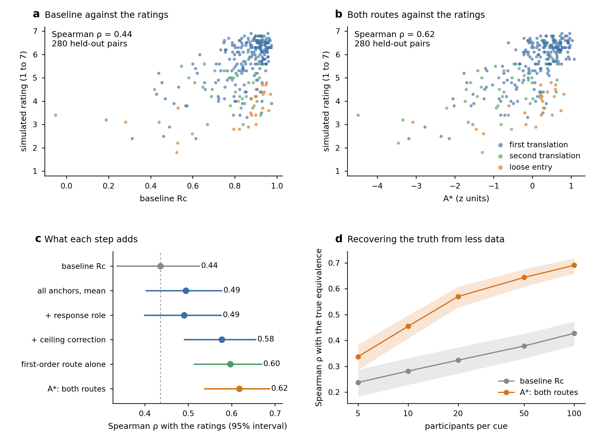
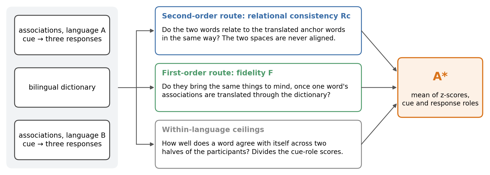

# Two bridges: what I learned from a word-association project

[](https://github.com/chunyunglo/two-bridges-demo/actions/workflows/ci.yml)

During a research internship at the Complex Human Data Hub (University of Melbourne) I worked
with Simon De Deyne on one question: how close are the meanings of a word and its translation,
and can word-association data tell us?

This repository is my own record of what I learned along the way. It is not the repository of
a paper and it does not contain the project's analysis. I rebuilt the core of the method as a
small package and run it on a **synthetic** bilingual world in which the right answer is known,
so that each lesson below points at something you can run. There are no real association
norms, no human ratings and no results from the project here.



*All four panels come from simulated data. **a, b** Baseline and combined score against simulated
similarity ratings for 280 held-out dictionary pairs. **c** What each step from the baseline to
the combined score adds (Spearman correlation, 95% bootstrap interval). **d** How well each score
recovers the true equivalence of 1,215 dictionary pairs as the number of participants per cue
grows.*

## The problem

A bilingual dictionary says that two words translate each other. It does not say how well.
People can rate that, and such ratings exist for a few thousand word pairs. For everything else
one needs a measure.

Word-association norms are a natural source. In the Small World of Words project, participants
see a cue word and write down the first three words that come to mind; the same task has been
run in many languages. The question is whether the associations collected in two languages,
linked only by a dictionary, predict how similar people judge a word and its translation to be.

## The idea: use the dictionary twice



| Route | It asks | How |
|---|---|---|
| **Second-order: relational consistency (Rc)** | Do the two words relate to other words in the same way? | Take the dictionary pairs as anchors. Measure how similar word *e* is to each anchor within language A, and how similar word *c* is to the anchors' translations within language B. Rc is the correlation of the two profiles. Only within-language similarities are used, so the two spaces are never aligned. |
| **First-order: fidelity (F)** | Do the two words bring the same things to mind? | Translate the association distribution of *e* word by word through the dictionary and compare it with the association distribution of *c* (Bhattacharyya coefficient), in both directions. |

Each route is computed in two roles: the word as a cue (what it evokes) and the word as a
response (what evokes it). The cue-role scores are divided by a **within-language ceiling**: the
score a word obtains against itself when the participants are split into two halves. The
combined score **A★** is the mean of the z-scores of the four components, so a pair is still
scored when only one role is available.

The baseline is an earlier definition of Rc that keeps only positively related anchors and the
best-matching translation of each anchor.

## Run it

```bash
git clone https://github.com/chunyunglo/two-bridges-demo.git
cd two-bridges-demo
pip install -r requirements.txt
python demo.py          # the demonstration
python -m pytest -q     # 11 tests
```

`demo.py` takes about two minutes on a laptop (under 1 GB of memory) and rewrites
`results/*.csv` and the two figures. `python demo.py --quick` is a shorter first look. The
run is deterministic: the committed tables are what the script produces with its fixed seed.

## What I learned

### 1. Build a world where you know the answer

With real data there is no way to see the quantity a measure is trying to estimate; there are
only noisy human ratings of it. So I wrote a small world in which that quantity exists
(`twobridges/synth.py`). 1,200 concepts lie in a latent meaning space. Each has a word in
language A and a translation in language B that sits at the same point plus a drift, small for
close equivalents and larger for loose ones. Simulated participants see a cue and give three
responses, which are more likely the closer they lie to the cue and the more frequent they are.
Simulated raters judge half of the 1,680 dictionary pairs on a seven-point scale. The **true
equivalence** of a pair is the cosine between its two latent points; the method sees only the
response tokens and the dictionary.

Spearman correlations, with intervals from 2,000 bootstrap resamples of words
(`results/performance.csv`):

| Pairs | Compared with | Baseline Rc | A★ | A★ − baseline [95% CI] |
|---|---|---|---|---|
| 280 rated dictionary pairs, held-out half | simulated ratings | 0.44 | **0.62** | +0.18 [0.11, 0.25] |
| 1,215 dictionary pairs | true equivalence | 0.38 | **0.64** | +0.26 [0.22, 0.30] |
| 1,059 pairs that are not dictionary entries | simulated ratings | 0.83 | **0.84** | +0.01 [0.00, 0.02] |
| 1,059 pairs that are not dictionary entries | true equivalence | 0.89 | **0.91** | +0.02 [0.01, 0.03] |

The gain is largest where the task is hardest: telling a good translation from a slightly worse
one. Across pairs that range from unrelated to near-synonymous, every score does well and the
gain is small. A single correlation would have hidden that distinction.

### 2. Look for invariances before adding a step

It is natural to rotate one language's space onto the other before comparing them. Rc cannot
change under a rotation of either space, because it only uses similarities measured within each
language. A short proof therefore removes a whole pipeline stage, and a test keeps it removed:
`test_rc_is_invariant_to_orthogonal_maps` in `tests/test_routes.py`. I now ask what a quantity
is invariant to before I try to improve it.

### 3. Know the ceiling

A cross-language score is limited by how consistent each word is with itself. Splitting the
participants into two halves and comparing a word with itself gives that limit
(`self_consistency` and `self_fidelity` in `twobridges/routes.py`). A score of 0.6 means
something different for a word whose ceiling is 0.65 than for one whose ceiling is 0.95.

### 4. Keep design and evaluation apart

In the project, English words were split into a development half and a test half by a hash
before any modelling; every choice was made on the first half, the method was fixed, and the
second half was scored once. `split_of` in `twobridges/pipeline.py` is that rule, and the demo
reports the held-out half. The split costs half the data and buys a number that can be
believed.

### 5. Report a difference together with its uncertainty

Two correlations computed on the same pairs are not independent, and pairs that share a word
are not independent either. `evaluate` resamples whole words and reports the paired difference
between a score and the baseline with its interval. In panel c the intervals of neighbouring
steps overlap; whether a step helped is a question about the paired difference
(`results/performance.csv`), not about which dot lies further right.

### 6. A simulation is not the world

In this synthetic world the ceiling correction helps a great deal (0.49 → 0.58 in panel c). On
the project's real held-out ratings it added almost nothing. The world was written with the
same picture of meaning that the method assumes, and it is far tidier than a language. It shows
that the code estimates what it claims to estimate when the truth is known; it is not evidence
about people. I set its parameters once, so that its association statistics resemble those of
real norms (the most frequent response to a cue takes about 11% of its responses), and did not
adjust them afterwards. Three other worlds (`python demo.py --seed 1 --out other`, likewise 2
and 3) give the same ordering: A★ exceeds the baseline on the held-out ratings by 0.13, 0.18 and
0.12, each with an interval above zero. The size of the last step varies: in two of those worlds
the second-order route with the ceiling correction does as well as A★.

### 7. Most ideas do not help, and each deserves a fair trial

During the project many candidate improvements were tried, from explicit alignment and optimal
transport to random walks and choice models. Most left the result where it was. Two habits came
out of that. A null result is worth writing down, because it stops the same idea from being
tried again. And an idea tested at a single setting has not been tested: one method turned out
to have been under-tuned on the first pass.

### 8. A higher correlation is not automatically a better measure

Ratings are noisy and reflect more than meaning. A score can gain correlation by picking up
something else that the ratings also carry. In the simulation this can be checked directly,
because every score can be compared with the truth as well as with the ratings (the second and
fourth rows of the table above). With real data the check has to be indirect, for example by
asking whether a score relates to other properties of words in the way the ratings do.

### 9. Coverage and data cost are part of performance

The baseline needs both words to have been cues, which here is 1,215 of the 1,680 dictionary
pairs. A★ scores all 1,680 by falling back on the response role (`results/coverage.csv`). It
also needs less data: with 10 participants per cue it recovers the truth about as well as the
baseline does with 100 (0.46 against 0.43, panel d).

### 10. A small machine is a useful constraint

Everything was developed on a laptop with 8 GB of memory. Sparse count matrices, batched
products, fixed seeds and one job at a time were necessary there, and they are also why this
demo runs anywhere in two minutes and gives the same numbers every time.

## Use it on your own data

```python
from twobridges import TwoBridges

# en, zh:  one row per response token, with the columns pid, cue, response
# lexicon: one row per translation pair, with the columns English, Chinese
model = TwoBridges(en, zh, lexicon, rank=200)
scores = model.score()             # every dictionary pair
other = model.score(my_pairs)      # any pairs, scored with the same frozen constants
```

The column names come from the English–Mandarin project; any two languages work. The Small
World of Words norms are available from the project at <https://smallworldofwords.org>.

## Layout

```text
twobridges/spaces.py     counts → PPMI → SVD; cue-role and response-role vectors
twobridges/routes.py     relational consistency, fidelity, within-language ceilings
twobridges/pipeline.py   the combined score A★, the hash split, the cluster bootstrap
twobridges/synth.py      the synthetic bilingual world
demo.py                  runs everything; writes results/ and figures/
tests/                   11 tests: definitions, invariance, the pipeline on a small world
```

## Acknowledgements

The project behind these notes was carried out with Simon De Deyne at the Complex Human Data
Hub, Melbourne School of Psychological Sciences, The University of Melbourne. This write-up and
any mistakes in it are mine.

The ideas build on the Small World of Words norms (De Deyne et al., 2019, *Behavior Research
Methods*) and on the relational-consistency measure of Liu, Chen and Yang (2025, *Behavior
Research Methods*). The code was developed with the assistance of an AI system (Claude,
Anthropic).

Code released under the [MIT licence](LICENSE).

## 中文簡介

這個 repo 是我在墨爾本大學 Complex Human Data Hub 研究實習期間，與 Simon De Deyne 合作一個專案時
學到的東西的整理，不是論文的 repo，也不含專案本身的分析。專案的問題是：一個詞和它的翻譯，意思
到底有多接近？能不能只用「詞語聯想」資料來估計？

我把方法的核心重寫成一個小套件，並放在一個**合成**的雙語世界上執行；這個世界的正確答案是已知的，
所以上面每一條心得都對應到可以實際執行的程式。內容包括：先造一個知道答案的世界來驗證方法、在加
步驟之前先找不變性、估計分數的上限、把設計與評估分開、差異要連同不確定性一起報告、模擬不等於
真實、多數點子沒有幫助而且每個都該被公平地試過、相關更高不代表量得更好、涵蓋率與資料成本也是
表現的一部分，以及小機器帶來的好習慣。repo 內沒有任何真實的聯想常模、人類評分或專案結果。
